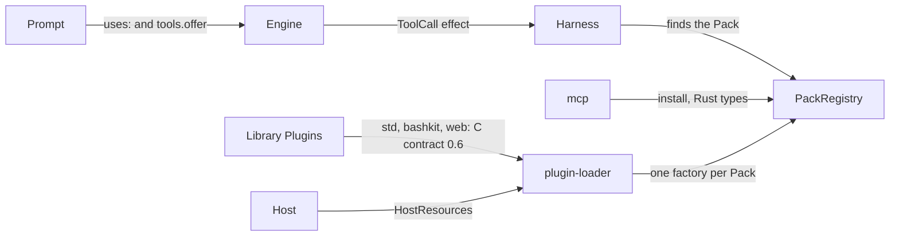
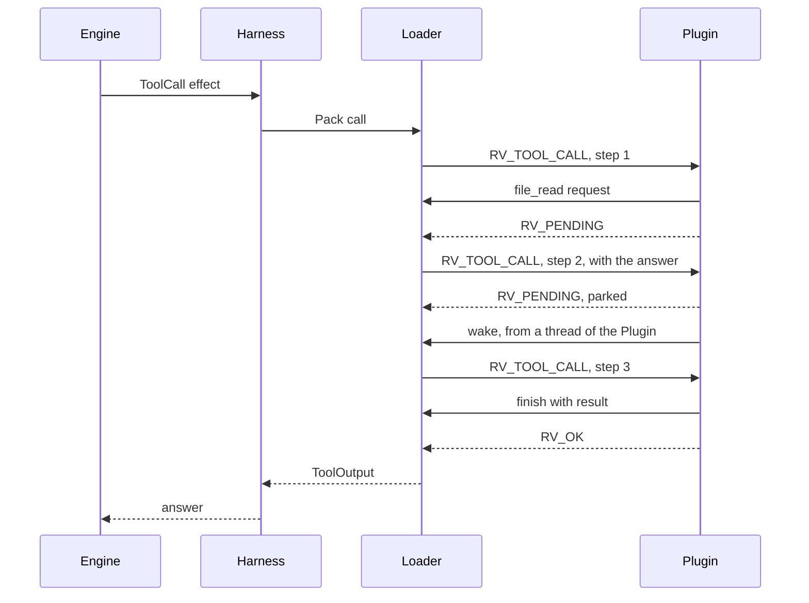

# How Runvil Plugins Work

*From a Plugin to a tool call, explained three times, each time in more detail, as the code stands on 2026-11-20*

This tutorial is for a Rust developer who is new to Runvil and is about to own its Plugin system. You have written a prompt, and you have written a Plugin that is linked into the Host and adds a Pack with one tool that fetches from a website. Now you need the whole picture: the Plugin API, the SDK, what a Plugin can and cannot do, and where the two are heading. The tutorial tells the same story three times: in one paragraph, in five, and then section by section with the detail a programmer needs.

Read all of it as a snapshot. The Plugin system is being built a piece at a time, and what is here is what exists now, not the final design. Three of the four shipped Plugins are libraries that cross one small C contract. The fourth is compiled into the Host and written against a Rust API, because it needs things the contract has no form for yet. Wherever something is missing, the text says whether it is planned, left out on purpose, or undecided.

- Engine, Harness, and loader: `runvil-harness` at `f75aadb2`
- C contract and SDK: `runvil-plugin-api` at `74f9e08`, contract version 0.6
- `std` Plugin: `runvil-plugin-std` at `0eda071`
- bashkit Plugin: `runvil-plugin-bashkit` at `5afe8ff`
- web Plugin: `runvil-plugin-web` at `afc7f54`
- Workshop: `runvil-workshop` at `68c72495`
- What is planned and what is undecided: the pages `tools-and-packs.md`, `harness-and-host.md`, and `files-and-the-vfs.md` under `decisions` in `runvil-harness`

Everything below was read in the code at those commits. Nothing was built or run for this tutorial. Where a decision page or a doc comment says something else, the code wins, and section 13 lists the differences that are likely to trip you up.

## In one paragraph

A Runvil Plugin is an entry point that installs Packs, and a Pack is a named set of tools. A prompt asks for a Pack by listing it under `uses:`, and a section's Lua offers the Pack's tools to its model. When a model or a script calls one of those tools, the Engine does not run it. The Engine emits the call as an effect, and the Harness finds the Pack and runs the call. The Plugin API is the line between the Harness and the Pack: how a Plugin names itself, how it lists its Packs and tools, how a call runs and waits, how a tool reaches the files of its run, and how a Plugin gets what the Host offers it. Today that line exists twice. Three Plugins ship as dynamic libraries, `std`, `bashkit`, and `web`, and they cross a small C contract, version 0.6, through a safe Rust SDK. One Plugin, `mcp`, is compiled into the Host as Rust and uses a second API made of the Harness's own Rust types, because the contract has no form for four things: the caller of a call, the `describes_tools` flag, a configuration at install, and `Pack::render`. The direction of the project is one API, the contract, for both kinds, so that an improvement to one is an improvement to all. This tutorial describes both APIs as they are and lists every difference between them.

## In five paragraphs

Start with the three nouns. A tool is one operation the Harness performs for a run, such as fetching a page. A Pack is a named set of tools, such as `runvil/web`, whose two tools are `web/fetch` and `web/search`. A Plugin is an entry point that installs zero or more Packs. A prompt lists the Packs it needs under `uses:` in its frontmatter, and every Pack listed there is required: a Host that lacks one refuses the prompt before it runs. Inside a section, Lua offers tools to the model with `tools.offer`, and Lua can also call a tool itself with `tools.call`. Lua names a tool by its tool id, `web/fetch`. The model sees it under a wire name, `web_fetch`, and a call under either name reaches the same tool. The Host, such as Workshop, decides which Plugins exist at all. At startup it fills one `PackRegistry`, and every run it starts draws its Packs from that registry.

A Plugin has a short life cycle with four levels. The Host loads the Plugin once, and during the load the Plugin names itself and inserts its Packs. For each run that holds one of those Packs, the Host asks the Plugin for an instance of the Pack, and the instance lists its tools, which stay fixed for that run. Each tool call on that instance then runs as a series of short steps: a step either ends the call with a result or parks it, and a parked call gets its next step when the Plugin wakes it or when the Host has the answer to its file request. When the run ends, the Host frees the instance, and when the last holder of the Plugin lets go, the Host unloads it. What every run shares, such as an HTTP client, lives in the Plugin instance. What one run needs lives in the Pack instance. What one call needs lives in the call's own state. In the C contract those four levels are six verbs sent to one function.

Through the contract, a tool can do a definite set of things today. It receives its own name and the call's arguments as JSON text. It returns text that it marks as trusted or untrusted, or it fails with one of four kinds of failure and a message the model reads. It reads and changes the files of its run through nine file functions, and each one goes through the Host, so the run's file policy applies and the run's record holds the operation. It is lent the Host's resources, a JSON text of named values such as the address of the Gateway's web search, which is how a Host hands a library Plugin what it needs. And it can wait: a call that waits on a network reply or a timer is parked, and a thread of the Plugin wakes it when the wait is over. A tool cannot learn who called it, a Plugin is handed no configuration when it loads, and no Rust object of the Host's reaches it, so a Plugin that needs an async runtime brings its own. A Plugin also shares the Host's process, which brings rules of its own: no panic may cross the boundary, and every thread the Plugin started must stop before the unload returns.

There are two ways to write a Plugin today, and that is the main thing to understand before you change anything. The first is the contract. A Plugin written against `runvil-plugin-sdk` implements two traits, `Plugin` and `Pack`, and the SDK turns them into the C entry point. `std`, `bashkit`, and `web` are built this way, each in a repository of its own, and ship as dynamic libraries. The second is older. A Plugin crate inside `runvil-harness` exports a Rust function named `install`, which receives the Host's `PackRegistry` and whatever else it needs as plain arguments, and it implements a different `Pack` trait from the crate `runvil-plugin`. `mcp` is the one Plugin built this way, and it is compiled into Workshop. The second way can do more: a configuration, a Pack inserted as unavailable with a reason, a Lua prelude, readiness, per-model tool shaping, four more tool flags, the call's origin, and six more file operations. Every one of those is an internal API that a contract Plugin cannot reach. If people keep writing against it, there are two ways to do everything, and work on one never reaches the other.

So the first job is the inventory in section 9: every ability the Rust path has that the contract lacks, and whether a shipped Pack uses it. Four of them stand between `mcp` and the contract: a configuration for its list of servers, the caller of a call, the `describes_tools` flag, and `Pack::render`, through which its servers' tools are meant to reach a model. The rest have no shipped user and can wait. Every piece the contract has is in use by a shipped Plugin: the file functions by `std` and the shell, the waker by the shell and by `web`, and resources by `web`. The contract grows only when a Plugin that exists needs something, and while its major version is 0, every version is its own contract: a Plugin built for 0.6 loads only in a Host that speaks exactly 0.6. Expect it to change under you, and expect to be the one changing it.

## Section by section

Here is the same story again, one piece at a time.

### 1. The words and the map

Six words have one meaning each in every Runvil repository, and they are always capitalized.

- **Engine**: the crates that parse a prompt and step a run. The Engine performs no tool call itself. It emits an effect and waits for an answer.
- **Harness**: the crates that step the Engine, perform each effect, and record the run. The Harness's loader is the only production code that calls a Plugin's entry point.
- **Host**: an application that runs prompts through the Harness, such as Workshop. The Host chooses which Plugins load.
- **Pack**: code which installs an optional native prelude, an optional Lua prelude, and zero or more tools.
- **Plugin**: an entry point which installs zero or more Packs.
- **tool**: not capitalized. One operation with a name, a description a model reads, and a JSON Schema for its arguments.

The definition of a Pack is ahead of the code. Through the contract, a Pack is tools only. Through the Rust `install` path, a Pack is tools and an optional Lua prelude. No path has a native prelude.

The code is spread over six repositories.

| Repository | Crate or file | What it is |
|---|---|---|
| `runvil-plugin-api` | `crates/runvil-plugin-sys` | The C contract as raw Rust types, and the generated header `include/runvil_plugin.h` |
| `runvil-plugin-api` | `crates/runvil-plugin-sdk` | The safe Rust layer: the `Plugin` and `Pack` traits, `export_plugin!`, `entry`, and a fake Host for tests |
| `runvil-plugin-api` | `examples/hello-plugin` | The smallest complete Plugin |
| `runvil-harness` | `crates/harness-internal/plugin-loader` | The Harness's loader, which speaks the contract to every entry point, and `HostResources`, what a Host offers the Plugins it loads |
| `runvil-harness` | `crates/harness-internal/runner` | Picks the Packs of each run, makes their instances, and performs tool calls |
| `runvil-harness` | `crates/runvil-plugin` | The older Rust-only API: `PackRegistry`, `Pack`, `PackFactory`, `ToolContext` |
| `runvil-harness` | `crates/plugin-mcp` | The one Plugin written against `runvil-plugin` |
| `runvil-harness` | `crates/harness-gateway-client` | The Gateway client, with `provide_gateway_resources`, which offers library Plugins the Gateway's web search |
| `runvil-harness` | `crates/runvil` | The one crate a Host depends on. It re-exports the loader's items as `runvil::harness` and the Rust-only API as `runvil::plugin` |
| `runvil-plugin-std` | `crates/plugin-std` | The `std` Plugin, written against the SDK |
| `runvil-plugin-bashkit` | `crates/plugin-bashkit` | The bashkit Plugin, written against the SDK |
| `runvil-plugin-web` | `crates/plugin-web` | The web Plugin, written against the SDK |
| `runvil-workshop` | `crates/workshop/server/src/agents.rs` | Where Workshop fills its `PackRegistry` and the `HostResources` it hands its library Plugins |
| `runvil-workshop` | `crates/workshop/plugin-std`, `crates/workshop/plugin-bashkit`, `crates/workshop/plugin-web` | Three one-line crates that build the libraries Workshop ships |



A Pack gets into a Host in one of three ways today. Learn these three names, because the code and the docs use the word "linked" for two of them.

| Way | What the Plugin is | Written against | How the Host inserts it | Who uses it |
|---|---|---|---|---|
| Rust `install` | A Rust function, such as `install(packs, servers, runtime)` | `runvil-plugin` | The Host calls the function | `plugin-mcp` |
| Linked contract Plugin | A C entry point compiled into the Host, such as `runvil_plugin_sdk::entry::<P>` | `runvil-plugin-sdk` | `runvil::harness::insert_plugin(packs, entry, resources)` | Nobody ships one. The loader's unit tests use it |
| Library Plugin | A dynamic library that exports `runvil_plugin` | `runvil-plugin-sdk` | `runvil::harness::insert_plugin_dir(packs, directory, resources)` | `std`, `bashkit`, `web` |

The second and third ways are the same contract. Both go through one private `load` function in the loader, and nothing after it looks at where the entry point came from. The first way is a different API. When someone says a Pack is "linked in", ask which of the first two they mean: the crate docs of `runvil-plugin` call the first way a linked Plugin, while the loader's `PluginSource::Linked` means the second. In this tutorial, "the contract" means the second and third ways together, and "the Rust `install` path" means the first.

Two more Packs go through neither API. `runvil/user` and `runvil/subagents` are built into every `PackRegistry`, in `runvil-plugin/src/registry.rs`, and have no tools. A prompt that needs a person declares `user`, and the Harness makes that Pack unavailable to a run that has no user.

### 2. Your Plugin, seen from a prompt

A prompt reaches a tool through three names. Suppose a Plugin inserts a Pack named `acme/site` with one tool named `fetch`.

````markdown
---
name: front-page
runvil: 0
uses: [acme/site]
---

## Fetch

```lua
return tools.call('site/fetch', { url = 'https://example.com/' })
```
````

| Name | Example | Who writes it |
|---|---|---|
| Pack name | `acme/site` | The Plugin, when it inserts the Pack. A vendor and a Pack id joined by `/` |
| Pack id | `site` | Nobody. It is the second segment of the Pack name |
| Tool name | `fetch` | The Pack, when it lists its tools. One segment |
| Tool id | `site/fetch` | The Host forms it from the Pack id and the tool name. Lua uses it |
| Wire name | `site_fetch` | What the model calls the tool. The Pack may set one, or the Host derives it from the tool id by turning `/` and `.` into `_` |

Four rules follow from the code in `harness-internal/runner/src/packs.rs` and `runvil-plugin/src/registry.rs`, and each one matters to a Plugin author.

- **A bare `uses:` entry means the `runvil` vendor.** `uses: [web]` and `uses: [runvil/web]` are the same entry. A Pack from any other vendor is written in full, as `acme/site`.
- **A run holds every Pack the Host installed, whatever its vendor.** So a Pack named `acme/site` gets an instance in every run of its Host, and the run waits for that instance to be ready, whether or not the prompt declares it. A prompt that leaves the Pack out can still call `site/fetch` or offer it to a model.
- **A registry holds one Pack per Pack id.** The second Pack inserted under an id is refused, so a Host that has `runvil/web` refuses `acme/web` with ``Pack `acme/web` cannot take the Pack id web, which `runvil/web` holds``, and `web/fetch` names one tool on a Host.
- **Every `uses:` entry is required.** When the registry lacks the Pack, `Host::parse` refuses the prompt with a notice that begins `the environment cannot satisfy this prompt:` and has one line for each Pack, such as `- site is unavailable: acme/site is not installed`.

To put a tool in front of a model, a section's Lua offers it, as `tools.offer('site')` for the whole Pack or `tools.offer('site/fetch')` for one tool. At the section's first model round the Engine builds the tool list from those offers, and the model then sees each tool as a wire name, a description, and a parameter schema. That description and schema are text your Pack wrote, so they are part of your Plugin's interface as much as the code is. The language guide's chapter on tools covers the prompt author's side in full.

### 3. The contract: one function and six verbs

The contract is the file `crates/runvil-plugin-sys/src/lib.rs` in `runvil-plugin-api`. Its crate docs are the whole agreement in prose, and the C header is generated from it, comments included, so the two cannot disagree. Read that file once from top to bottom. It is about 770 lines before its tests, and nothing else in the system is as exact.

A Plugin is one function:

```c
RvStatus runvil_plugin(RvCall *call);
```

Every call passes an `RvCall` that names a verb. The struct has seven fields: its own `size`, the `verb`, a pointer to `host` (an `RvHost`, which holds the contract version the Host speaks and nothing else), a pointer to the verb's own arguments in `args`, and three pointers that belong to the Plugin: `plugin`, `pack_run`, and `tool_call`. The Host stores those three and passes them back, and it never reads through them. They are how the Plugin finds its own state at each of its levels.

| Verb | Number | Arguments | When the Host sends it | What the Plugin does |
|---|---|---|---|---|
| `RV_PLUGIN_LOAD` | 1 | `RvLoadArgs` | Once, as the Host inserts the Plugin | Makes its instance and sets `call->plugin`, names itself once, inserts each Pack |
| `RV_PLUGIN_UNLOAD` | 2 | none | When the last holder of the Plugin drops it | Frees `call->plugin` and stops every thread it started |
| `RV_PACK_NEW` | 3 | `RvPackNewArgs` | Once for each run that holds the Pack | Makes the run's instance and sets `call->pack_run`, adds each tool |
| `RV_PACK_DELETE` | 4 | none | When the run ends | Frees `call->pack_run` |
| `RV_TOOL_CALL` | 5 | `RvToolCallArgs` | Once for each step of a tool call | Does a bounded slice of work, then ends the call or parks it |
| `RV_TOOL_CANCEL` | 6 | none | When the Host abandons a call between two steps | Frees `call->tool_call` |

Numbers 7 and 8 are reserved, and so are status codes 1 to 3. The contract declares no constant for them. Older records name verb 7 for a prelude and verb 8 for a render step, which are two of the things section 9 lists as missing.

The Plugin talks back to the Host only through functions that come with a verb, inside that verb's arguments struct. Each one takes the struct's `ctx` as its first argument.

| Verb | Functions the Plugin may call | What each takes |
|---|---|---|
| `RV_PLUGIN_LOAD` | `refuse`, `describe_plugin`, `insert_pack` | A reason; an `RvPluginInfo` with a name and a version; an `RvPackInfo` with a name and a one-line description |
| `RV_PACK_NEW` | `refuse`, `add_tool` | A reason; an `RvToolInfo` with a name, a wire name, a description, the parameters as JSON text, and the tool's flags |
| `RV_TOOL_CALL` | `finish`, the nine file functions, and `wake` | An `RvToolResult` with a kind and a text; a path, and the bytes of a write; the `ctx` of the call's waker |

That table is the whole surface. If something is not in it, a contract Plugin cannot ask the Host for it. The nine file functions are `file_stat`, `file_list`, and `file_read`, which read, and `file_write`, `file_append`, `file_mkdir`, `file_remove`, `file_rename`, and `file_copy`, which change files. What the Host hands a step without being asked sits in the same `RvToolCallArgs`: the tool's name, the arguments, the answer to the last step's file request, the Host's resources, and the call's waker.

The rules that go with the surface are few, and the loader enforces each of them.

- **Strings are a pointer and a length**, in UTF-8, with no NUL at the end. Each has a limit in bytes, and a longer string is a misuse. The bytes of a write have a limit too.
- **What one side passes is valid only until the function returns.** The receiver copies what it keeps. A tool's name, its arguments, and the Host's resources are valid for one step, and so is the answer to a file request. The one thing that lasts is what the `ctx` of a waker points at, which the Host keeps until the Plugin is unloaded.
- **A function answers only while its own call runs, on that call's thread, with that call's `ctx`.** Any other use returns `RV_ERR_MISUSE`. A misuse on the call's own thread fails that call, whatever status the Plugin returns. A `ctx` saved from an earlier step is stale. `wake` is the one exception: the Plugin may call it on any thread, any number of times, from the call's first step until the unload returns.
- **Only the load has a fixed thread.** Every other verb may come on any thread, the steps of one call may come on different threads, and several calls may run at once. The Host promises three things: no two steps of one call run together, a delete comes after every call of its instance has ended, and an unload comes after every instance is deleted.
- **Every path frees exactly once.** A load the Host rejects gets no unload, and an `RV_PACK_NEW` the Host rejects gets no delete, so the Plugin frees what it made before it returns a failure. A call's state is freed by the step that ends the call, or by `RV_TOOL_CANCEL`, never both.
- **The entry point never unwinds.** A Rust panic across `extern "C"` aborts the Host's process.

| Status | Number | Meaning |
|---|---|---|
| `RV_OK` | 0 | Success |
| `RV_ERR_MISUSE` | 4 | The caller broke the contract |
| `RV_ERR_REFUSED` | 5 | The Plugin declined to load, or to make a Pack instance |
| `RV_ERR_UNSUPPORTED` | 6 | The Plugin does not know the verb, or was not built for the Host's version |
| `RV_PENDING` | 7 | The tool call is parked |
| `RV_ERR_FILE` | 8 | A file operation failed. No function returns it: it is the status of the answer to a file request |

| Limit | Bytes | What it bounds |
|---|---|---|
| `RV_MAX_NAME` | 64 | A name segment, a version, a wire name |
| `RV_MAX_LINE` | 1024 | A refusal reason, a Pack's description |
| `RV_MAX_PATH` | 4096 | A path a file function takes |
| `RV_MAX_TOOL_TEXT` | 65536 | A tool's description, and its parameters |
| `RV_MAX_RESULT` | 16,777,216 | The text of a tool call's result |
| `RV_MAX_WRITE` | 16,777,216 | The bytes of one write or one append |

Versions are strict. The contract's version is `RV_API_MAJOR`.`RV_API_MINOR`, which is 0.6 now, and the crate `runvil-plugin-sys` has the same version number. While the major version is 0, each version is a contract of its own: a Plugin checks the Host's version first in `RV_PLUGIN_LOAD` and answers any other version with `RV_ERR_UNSUPPORTED`. From 1.0, a minor version may only add. The crate also sets `links = "runvil_plugin"` in its manifest, so Cargo refuses to put two versions of the contract into one build.

Three decisions explain the shape, and the records give each a reason.

- **One function with verbs**, in place of a table of function pointers. Vinnie, when the loader was designed on 2026-10-20: "It's probably better if we just have one entry point and we do a verb on that. Otherwise, we start having function pointers here, function pointers there". One symbol to export, and a new version adds verbs.
- **Functions that hang off each verb**, in place of one big table on `RvHost`. The commit that made contract 0.2 says why: each verb has its own lifetime and thread rules.
- **A minimal contract.** The rulebook of `runvil-plugin-api` says: "The contract stays minimal. A verb, a field, or a function joins only when a Plugin that exists needs it, and each one says who calls it, on which thread, how long what it passes stays valid, and who frees what." This is why so much is missing, and it is also your process for adding something: find the Plugin that needs it first.

### 4. The SDK: the same contract in safe Rust

Most Plugins never touch the raw contract. `runvil-plugin-sdk` gives you two traits, and its generic function `entry::<P>` is the C entry point for any type `P` that implements `Plugin`. A Plugin written against it needs no `unsafe`.

```rust
use runvil_plugin_sdk::{
    BoxFuture, Pack, PackInfo, Plugin, Refusal, ToolCall, ToolError, ToolErrorKind, ToolInfo,
    ToolOutput, export_plugin,
};

/// The Plugin instance. What every run shares lives here.
pub struct Acme;

impl Plugin for Acme {
    const NAME: &'static str = "acme";
    const VERSION: &'static str = env!("CARGO_PKG_VERSION");
    const PACKS: &'static [PackInfo] =
        &[PackInfo::new("acme/site").description("Fetch pages from the Acme site")];

    fn load() -> Result<Acme, Refusal> {
        Ok(Acme)
    }

    fn new_pack(&self, _pack: &str) -> Result<Box<dyn Pack>, Refusal> {
        Ok(Box::new(Site))
    }
}

/// One run's instance of the Pack. What one run needs lives here.
struct Site;

impl Pack for Site {
    fn tools(&self) -> Vec<ToolInfo> {
        vec![ToolInfo::new(
            "fetch",
            "Fetch a page from the Acme site and return its text.",
            r#"{"type":"object","properties":{"url":{"type":"string"}},"required":["url"]}"#,
        )]
    }

    fn call<'a>(&'a self, call: ToolCall<'a>) -> BoxFuture<'a, Result<ToolOutput, ToolError>> {
        Box::pin(async move {
            match call.tool() {
                "fetch" => Ok(ToolOutput::untrusted(format!("got {}", call.arguments()))),
                other => Err(ToolError::new(
                    ToolErrorKind::Other,
                    format!("site has no tool named {other}"),
                )),
            }
        })
    }
}

export_plugin!(Acme);
```

Each piece maps onto the contract.

| SDK item | What it is | Contract side |
|---|---|---|
| `Plugin::NAME`, `VERSION`, `PACKS` | Constants the SDK reports during the load | `describe_plugin`, `insert_pack` |
| `Plugin::load()` | Makes the instance, once. Returns a `Refusal` to decline | `RV_PLUGIN_LOAD`, `refuse` |
| `Plugin::new_pack(&self, pack)` | Makes one run's instance of the named Pack | `RV_PACK_NEW` |
| `Pack::tools()` | The instance's tools, read once, fixed for the run | `add_tool` |
| `Pack::call(call)` | Returns a future the SDK polls once per step | `RV_TOOL_CALL`, `finish` |
| `ToolInfo::new(name, description, parameters)`, `.wire_name(name)`, and `.changes_files()` | A tool as data | `RvToolInfo` |
| `ToolCall` | What a call is lent: `tool()`, `arguments()`, `resources()`, and the ten file methods | `RvToolCallArgs` |
| `ToolOutput::trusted(text)`, `ToolOutput::untrusted(text)` | A successful result | Result kinds 1 and 0 |
| `ToolError::new(kind, message)` | A failed result. The kinds are `InvalidArguments`, `Backend`, `Transport`, `Other` | Result kinds 2 to 5 |
| `next_step()` | A future that ends the current step and asks for the next one right away | A wake, then a step that returns `RV_PENDING` |
| Dropping the Pack, the future, the Plugin | Cleanup | `RV_PACK_DELETE`, `RV_TOOL_CANCEL`, `RV_PLUGIN_UNLOAD` |

The SDK keeps the contract's rules so you do not have to.

- It checks the Host's version before it reads anything else.
- It checks `NAME`, `VERSION`, and `PACKS` when the Plugin is compiled. A name the Harness would reject fails the build of `entry::<P>`, with a message that names the rule.
- It copies the tool's name, the arguments, and the Host's resources on a call's first step, so they outlive the step, and it copies the answer to a file request before it polls your future.
- It polls your future with an ordinary Rust `Waker` over the Host's waker for the call. A future that waits on a timer, a channel, or a task of a runtime you own parks its call and is woken like any other future.
- It turns a panic into something the Host can handle. A panic in `load` becomes a refusal that reads `the Plugin panicked while loading: ...`. A panic in `new_pack` or `tools` becomes a refusal that reads `the Pack panicked while it was made: ...`. A panic in a call ends that call as a failure that reads `the tool panicked: ...`, and the Pack instance lives on. This works only with Cargo's default `panic = "unwind"`.

Four things it does not do, and each one catches people.

- **It does not check a `ToolInfo`.** A bad tool name, wire name, or schema is found by the Host during `RV_PACK_NEW`, as a misuse, and the run then goes without the whole Pack. The SDK's fake Host makes the same checks, so a test finds it first (section 11).
- **It has no JSON library.** Arguments, schemas, and the Host's resources cross as text. Your Pack parses `call.arguments()` and `call.resources()` with a library of its own, as `std` and `web` do with `serde_json`.
- **The runtime is yours to bring.** The SDK polls your future and hands it a waker, and that is all. Work that needs a tokio runtime, such as an HTTP request, needs a runtime the Plugin owns, and the Host's thread that polls the call is outside that runtime. A future that returns `Pending` without arranging a wake, and without a file request, parks for good. Section 5 covers what that means, and section 10 shows how `web` does it.
- **`new_pack` and `tools` must be instant.** They run while the Host prepares a run, so they do not block and do no I/O. `Pack::call` has a catch of its own: the function returns before its future is first polled, so it can build the future of a file method and cannot have its answer. Await file methods inside the returned future.

Thread bounds follow from the contract. `Plugin` requires `Send + Sync`, because the Host makes Pack instances on any thread. `Pack` requires `Send + Sync`, because calls on one instance may run at the same time. The future `call` returns is `Send`, because its steps may come on different threads.

### 5. One tool call, step by step

Follow one call from the model to your code and back.



1. **The Engine emits an effect.** A model's reply asks for a tool, or a script calls `tools.call`. The Engine emits a `ToolCall` effect with the tool id and the arguments, and it waits.
2. **The Harness finds the Pack.** The run's snapshot looks up the Pack by the first segment of the tool id and calls the Rust `Pack::call` on the instance. At most 10 tool calls of one run are in flight at a time, which is the default of `RunSetup::max_tool_calls_in_flight`. The rest wait, unstarted.
3. **The loader turns the call into steps.** For a contract Pack, the instance is the loader's own type, and its `call` returns a future. When the call starts, the loader reads the Host's resources once, and every step of the call is lent that same text. Each poll of the future sends one `RV_TOOL_CALL` at most, as a plain function call on the polling thread. Nothing is sent before the first poll, and nothing while a file request waits for its answer.
4. **The SDK polls your future once.** In the first step the SDK calls your `Pack::call` and polls the future it returns. In each later step it polls again. `Pending` becomes `RV_PENDING`. `Ready` becomes a call to `finish` and `RV_OK`.
5. **The loader judges the step.** A misuse fails the call. `RV_PENDING` with no result parks the call. `RV_OK` with a result is the result. `RV_OK` with no result fails the call, and so does any other status.
6. **The answer goes back.** The loader turns the result kind into a trusted `ToolOutput`, an untrusted one, or an error. The Engine wraps untrusted text in an envelope before a model reads it, so mark as untrusted any output that holds data an attacker can influence, such as a web page or the contents of a file. The loader takes your word for it.

Three facts about steps shape every Pack you write.

**A step runs inside the run's own future.** The Harness starts no task for a run. One future drives the whole run, and each step of each tool call runs on whatever thread polls it. So a step that blocks, or computes for a long time, stalls its run. The bashkit plan records what that looks like in practice: a slow script "freezes its run, and the Stop button with it, until the script ends". The rule in the contract is that a step does a bounded slice of work and returns.

**A call that waits is parked.** A step that returns `RV_PENDING` parks its call, and the Host owes it no step until one of two things happens. When the step made a file request, the answer brings the next step. Otherwise the Plugin wakes the call through the waker that every step is lent, on any thread, at any time until the Plugin is unloaded. So a call that waits on a network reply or a timer costs the run nothing while it waits: its step returns pending, a thread of the Plugin's own runtime does the waiting, and that thread wakes the call when the wait is over. In the SDK your future gets this for free, because the waker is its ordinary Rust `Waker`. A call that nothing wakes stays parked until the Host abandons it. A wake that comes late is harmless: the Host keeps what a waker points at until the unload, so a timer that fires after its call ended does nothing for that call.

**A long job yields on purpose.** A future that has real work to do awaits `next_step()` every so often, which ends the step, wakes the call, and continues at the next step. The `std` Plugin's Grep does this after every 32 files or directories, so a search over a big tree is many short steps. Awaiting a file method ends the step too, so a job needs `next_step()` only where it works for long between two file operations. The pattern, as a sketch:

```rust
for path in paths {
    search(&call, path)?;
    seen += 1;
    if seen % 32 == 0 {
        next_step().await;
    }
}
```

The Host can abandon a call only between two steps, and it can abandon a parked call at any time. A stop from the user drops the tool calls in flight and the run goes on. A cancel drops everything and the run ends. For a contract Pack, dropping the call's future sends `RV_TOOL_CANCEL` once if the last step returned `RV_PENDING`, and the SDK drops your future there. That drop is your only cancel signal. Put cleanup for a call in the `Drop` of what the future owns, and do not count on file access inside it.

### 6. Files

A tool reaches the files of its run only through its `ToolCall`.

```rust
impl<'a> ToolCall<'a> {
    pub fn stat(&self, path: &str) -> FileFuture<'a, Stat>;
    pub fn list(&self, path: &str) -> FileFuture<'a, Vec<DirEntry>>;
    pub fn read(&self, path: &str) -> FileFuture<'a, Vec<u8>>;
    pub fn read_range(&self, path: &str, offset: u64, len: u64) -> FileFuture<'a, Vec<u8>>;
    pub fn write(&self, path: &str, bytes: impl Into<Vec<u8>>) -> FileFuture<'a, ()>;
    pub fn append(&self, path: &str, bytes: impl Into<Vec<u8>>) -> FileFuture<'a, ()>;
    pub fn mkdir(&self, path: &str, recursive: bool) -> FileFuture<'a, ()>;
    pub fn remove(&self, path: &str, recursive: bool) -> FileFuture<'a, ()>;
    pub fn rename(&self, from: &str, to: &str) -> FileFuture<'a, ()>;
    pub fn copy(&self, from: &str, to: &str) -> FileFuture<'a, ()>;
}
```

Each method returns a `FileFuture`, as in `call.read(path).await`, and the future resolves to what the method names or to a `FileError`. Awaiting it ends the step with a request to the Host. The Harness performs the operation between two steps of the call, as an effect of the run, and the call's next step goes on with the answer. Three things follow. The run's file policy applies to every operation, so a path the policy denies fails like any other. The run's record holds every file operation of a tool, a read as well as a change. And the tool sees the run's virtual files, not the machine's disk. Vinnie gave the reason in class on 2026-11-06, speaking of a Plugin that wants to do file I/O: "It has to do it through the virtual file system. Because if it doesn't, then that means that the the tools in the plug-in are not going to be able to see any virtual files that have been mounted, like you can't see the store."

The rules are short.

- **Paths** use `/` between segments and are taken from the run's root whether or not they begin with `/`. A `.` segment changes nothing, a `..` segment steps up, and a `\` is read as `/`. A path is at most 4096 bytes.
- **Links.** `stat`, and each entry of `list`, describe a link as a link. `mkdir`, `remove`, and `rename` act on a link itself, and every other method acts on what a link leads to.
- **A `Stat` is a file type and a length.** The types are `File`, `Directory`, `Symlink`, and `Other`.
- **A failure does not end the call.** A file future resolves to a `FileError` with a kind and the Host's words for what went wrong, and your tool decides what the model reads. The kinds are `NotFound`, `NotADirectory`, `IsADirectory`, `Denied`, `Conflict`, `Io`, `AlreadyExists`, `NotEmpty`, and `Other`. The contract defines `Conflict` for a clash between two tool calls, and the Harness reports each failed operation under one of the other kinds.
- **An answer comes only with a step.** A file method is awaited inside the future that `Pack::call` returns. The Host takes one request of a call at a time, so file futures that wait together go to the Host one with each step. A file future gets its answer only when a step polls it, so it does not work inside a set that polls a child only after that child's waker fired, such as `FuturesUnordered`.
- **The Host holds what it hands back in memory.** Check `stat` first, or use `read_range`, when a file may be large. One `write` or `append` takes at most 16 MiB, so a tool writes a longer file as one `write` and then one `append` for each further part.
- **A tool that changes files says so.** A tool that awaits `write`, `append`, `mkdir`, `remove`, `rename`, or `copy` sets `ToolInfo::changes_files()`. Of the calls that one reply of a model asks for, the Host then runs each call of that tool by itself, so two changes of one reply happen in the order the reply lists them.
- **A dropped call leaves what it did.** When the Host abandons a call, an operation the Host had taken either happened in full or did not happen.

Contract 0.6 has nine file functions, and the Host's own list of file operations, `VfsOp`, has fifteen. The six without a function are ones a tool builds from the nine, or does without.

| Operation in the Host's `VfsOp` | Contract 0.6 |
|---|---|
| `Stat`, `List`, `ReadRange` | `file_stat`, `file_list`, `file_read` |
| `Write`, `Append` | `file_write`, `file_append` |
| `Mkdir`, `Remove`, `Rename`, `Copy` | `file_mkdir`, `file_remove`, `file_rename`, `file_copy` |
| `Exists` | None. A `file_stat` answers it |
| `Read`, `ReadNumbered`, which read text by lines | None. A tool reads bytes with `file_read` |
| `StrReplace` | None. A tool reads the file and writes it back |
| `Delete`, which also succeeds on an absent path | None. `file_remove` fails on an absent path |
| `Glob` | None |

The two shipped Packs that work with files are both on the contract.

- **`std`** has seven tools. Read, ListDir, Grep, Write, StrReplace, and Delete work. Glob answers a fixed text that begins "The Glob tool is not implemented in this build." StrReplace is a read and then a write, and Delete is a stat and then a removal, because the contract has no function that does either in one operation.
- **`bash`** runs a shell over the run's files. A script reads them and changes them through the same nine functions, so a redirect, `sed -i`, `cp`, `mv`, `rm`, and `mkdir` all reach the run's files under the run's policy. Each call builds a shell of its own, so a working directory, a variable, or a function ends with its call, and the next call finds the run's files alone.

The bashkit Plugin shows what the nine functions leave out. The contract reports what a path names and how long a file is, and it has no function for a mode, a time, a link, or a named pipe. So the shell answers those itself: a file shows mode 644 and a directory 755, every time is the start of 1970, and `ln` and `mkfifo` fail.

The question from class is closed. On 2026-11-06 Vinnie asked whether the file functions a Plugin gets should be synchronous or asynchronous, and said "Reversing the choice is expensive". On 2026-11-15 he decided it, and the answer has four parts, which the code follows.

- **Storage stays synchronous.** The backends and the Host's file access are synchronous, because the storage underneath is. His words: "at the end of the day, the operating system calls are synchronous. So we keep the storage operations synchronous." The Harness performs each file operation with one blocking call, and the run waits for it.
- **A tool's file operations are effects.** His rule: "every VFS operation that's performed by a tool has to turn into an effect in the engine." The tool asks, the Engine issues the effect, the Harness performs and records it, and a later step of the call receives the answer. That is why a tool call is an async function and the file methods of `ToolCall` return futures. The reason is the record: a replay and a debugger need every file operation of a run.
- **A tool's result depends on the call's arguments, the run's files, and what the tool reaches outside the run.** His rule: "Tools are not allowed to have internal states, and if they do, they have to be recorded." A replay feeds each recorded tool result back and runs no tool, so a run that went on live afterward would call a tool that had lost what its earlier calls left. The shell is the tool this rule shaped: each Shell call gets a shell of its own.
- **A remote system is a tool's job.** A Host may mount slow storage, and the run that uses it waits for it. Anything that needs a timeout, a retry, or a sign-in goes through a tool, which the Harness can drop while it waits.

### 7. How the Harness loads a contract Plugin

The loader is the crate `harness-internal/plugin-loader` in `runvil-harness`. A Host reaches it through two functions that the `runvil` crate re-exports.

```rust
// runvil::harness
pub fn insert_plugin_dir(
    packs: &mut PackRegistry,
    directory: &Path,
    resources: &HostResources,
) -> io::Result<PluginReport>;

pub fn insert_plugin(
    packs: &mut PackRegistry,
    entry: PluginEntry,
    resources: &HostResources,
) -> Result<Arc<Plugin>, Error>;
```

`insert_plugin_dir` is the library route. It lists the top-level files of one directory whose extension is the platform's library extension, sorts them by file name, opens each one, looks up the one symbol `runvil_plugin`, and sends it `RV_PLUGIN_LOAD`. One library's failure never stops the others. `insert_plugin` is the linked route: it takes an entry point that is already compiled into the Host and sends it the same load. From there on the two are one code path.

What happens during and after a load:

- **The Plugin describes itself and inserts its Packs.** The loader checks every name, version, and description, and a broken rule is a misuse that fails the load. A load that never calls `describe_plugin` fails too.
- **Each Pack becomes a factory in the registry.** When a run needs the Pack, the factory sends `RV_PACK_NEW`, collects the tools the Plugin adds, and wraps the result in an instance that implements the Harness's Rust `Pack` trait. That wrapper is how the rest of the Harness treats every Pack alike.
- **The instance is a thin wrapper, and that is where the gaps come from.** Its tool list is the one fixed at `RV_PACK_NEW`. Its `ready` and `render` are the trait's defaults. Its Pack info never has a prelude. Each tool it lists has every flag off except `changes_files`, which follows the flag the Plugin set. Its `call` passes the tool's name, the arguments, and the call's files to the steps, and drops the call's origin. Section 9 turns this into a table.
- **A loaded Plugin is reference counted.** The `PluginReport`, each factory in the registry, and each run's instance hold it. When the last holder drops it, the loader sends `RV_PLUGIN_UNLOAD` and then closes the library. A Host has no unload call to make.
- **A refusal has two sizes.** A Plugin that refuses its load fails as a whole, none of its Packs go into the registry, and a prompt that declares one is told the Pack is not installed. A Plugin that refuses in `RV_PACK_NEW` makes that Pack unavailable to that one run, with the Plugin's own reason, and the next run asks again.

The `PluginReport` is what a Host learns from a directory. `plugins()` lists each Plugin that loaded, with `name()`, `version()`, and `source()`. `failures()` lists each failure, with the library's path and a reason tag: `open`, `missing_entry`, `refused`, `misuse`, `status`, `undescribed`, `duplicate`, or `pack`.

**Resources are how a Host hands library Plugins what they need.** A Rust object stays on the Host's side of the contract, so a Host offers JSON values under names of two segments, a vendor and a name, such as `runvil/web-search`. It fills a `HostResources` and passes it to both insert functions, and each Plugin they load keeps a clone.

```rust
impl HostResources {
    pub fn new() -> HostResources;
    pub fn provide(
        &mut self,
        name: &str,
        read: impl Fn() -> Option<Value> + Send + Sync + 'static,
    ) -> Result<(), Error>;
}
```

`provide` takes a name and a function that returns the resource's value, or `None` to leave the resource out of that call. It refuses a name that is not a vendor and a name, and a name that is offered already. The loader calls each function as a tool call starts, so the function returns at once, and every step of that call is lent the same text: one JSON object with a key for each resource, and `{}` when the Host offers none. A Host whose value stays the same passes a function that returns it, and a Plugin with no use for the resources ignores them.

The Gateway's web search is the resource that exists today. `provide_gateway_resources` in `harness-gateway-client` offers one entry, which the web Plugin reads:

```json
"runvil/web-search": {
  "version": 1,
  "url": "http://127.0.0.1:52814/v1/tools/web_search",
  "api_key": "..."
}
```

Version 1 means: send the Gateway's web search request as the JSON body of a POST to `url`, with `api_key` as the bearer when the entry has one. The name and the shape are written in both repositories, because a Plugin may not depend on a Harness crate, and a test on each side pins the same JSON. The entry holds the Gateway's key as plain text, and every Plugin that is lent the resources can read it.

Two platform facts will save you an afternoon.

- **On Windows, a Plugin's own DLL dependencies resolve only from the Plugin's directory and System32.** The loader opens each library with search flags that say so. Link a Plugin with the static C runtime so it needs no runtime DLLs, as `runvil-plugin-api` does in its `.cargo/config.toml`.
- **Every library in the directory is opened.** A dependency DLL that sits beside a Plugin is opened too, and shows up in `failures()` as `missing_entry`.

Both insert functions are safe Rust that runs foreign code, and nothing can check a C entry point. The docs put the duty on the Host: it points the loader only at libraries it trusts. A library in a Plugin directory runs with the Host's full rights. There is no sandbox and no signature check, and none is planned in any record.

Here is how Workshop uses all of this, in `crates/workshop/server/src/agents.rs`. `resources` builds what the server offers its library Plugins, and `with_plugins` fills the registry:

```rust
fn resources(registry: &Registry) -> HostResources {
    let mut resources = HostResources::new();
    let registry = registry.clone();
    // The first offer on empty resources, so the Gateway's name is free
    // and the call cannot be refused.
    let _ = provide_gateway_resources(&mut resources, move || reachable_gateway(&registry));
    resources
}
```

```rust
let mut packs = PackRegistry::new();
if let Ok(runtime) = tokio::runtime::Handle::try_current()
    && let Err(error) = plugin_mcp::install(&mut packs, servers, runtime)
{
    tracing::warn!(%error, "the mcp Plugin inserted no Pack");
}
let report = plugins.and_then(|directory| load_plugin_dir(&mut packs, directory, resources));
```

One Rust `install` call, then one directory of libraries, which `load_plugin_dir` passes to `insert_plugin_dir` with the resources. Three details of that file are worth knowing.

- **`reachable_gateway`** returns the endpoint and the key of the Gateway that the server's registry holds. The Harness asks for it as each tool call of a library Plugin starts, so a replaced Gateway serves the next call. It returns nothing when no Gateway is registered, when the heartbeat reports the Gateway down, and when the Gateway's URL or key cannot build. A call that starts then is lent resources without the Gateway's entry, and a search in it fails with `web_search: the host offers no web search right now`.
- **`mcp` is installed only on a tokio runtime**, whose handle `install` takes. A Host built outside one, as a synchronous test builds it, has no `mcp` Pack and refuses a prompt that requires it.
- **`SHIPPED_PACKS`** names `runvil/std`, `runvil/bash`, and `runvil/web`, the Packs that only a library Plugin inserts. After the directory loads, `with_plugins` emits a `tracing` warning for each one the registry lacks, because an agent that requires it is refused.

Workshop never calls `insert_plugin`. Its Plugin directory is named `plugins` and ships with the app: beside `runvil-workshop.exe` on Windows, inside `Runvil.app/Contents/Resources` on macOS, and under `usr/lib/runvil` inside the AppImage on Linux. The setting `[agents] plugins` in `workshop.toml` names another directory. Running `runvil-workshop --plugins` lists what the directory loads and what failed, which is the only place a person sees a `PluginReport`, because Workshop keeps no log. With the three shipped libraries it prints `bashkit 0.1.0`, `std 0.1.0`, and `web 0.1.0`, one Plugin on each line, in the order of the library file names. It can never show `mcp`, because a Rust `install` call leaves no Plugin object behind.

### 8. The second API: Rust `install`

Now the older path. It lives in `crates/runvil-plugin` in `runvil-harness`, and a Host sees it as `runvil::plugin`. One shipped Plugin is written against it, `plugin-mcp`, and this is its entry:

```rust
pub fn install(packs: &mut PackRegistry, servers: Value, runtime: Handle) -> Result<(), Error>
```

`install` is a naming convention. No trait names it, and the Host calls it like any function, so it takes what it needs as plain arguments. Here `servers` is the list of MCP servers, the `mcpServers` object of an `mcp.json` file, and `runtime` is the handle of the Host's tokio runtime, on which the Pack connects to its servers and runs its calls. A `null` server list means no servers, and any other value that is not an object inserts the Pack as unavailable, with the reason. The rest of what a Rust Plugin touches is a Rust type of the Harness or the Engine.

| Item | What a Plugin does with it |
|---|---|
| `PackRegistry` | `insert(info, factory)` adds a Pack. `insert_unavailable(info, reason)` adds it with a reason it cannot serve, so a prompt that declares it is refused with that reason. `list()` shows what the registry holds |
| `PackInfo` | The Pack's name, a description, and an optional Lua prelude that the Engine runs in every section of a prompt that declares the Pack |
| `PackFactory` | `new_pack(&self, id: &PackId)` makes one run's instance. A plain closure is a factory |
| `Pack` | Four methods: `tools()`, `ready()`, `call(cx, args)`, and `render(cx, offered)` |
| `ToolContext` | What one call is lent: `tool()`, the tool id; `files()`, through which the call asks for file operations; `origin()`, who made the call |
| `ToolInfo` | The Engine's own catalog type, with a wire name and five flags: `structured_output`, `survives_stop`, `describes_tools`, `model_only_call`, `changes_files` |
| `ToolFiles` | `request(op)` asks for one operation of `VfsOp`, any of the fifteen in section 6, and resolves with its outcome |
| `Error` | The universal error type of the Engine and the Harness, with codes, causes, and facts |

**Why `mcp` is compiled into the Host.** What keeps it on this path is what the contract has no form for. It marks its output by the caller of the call, trusted for a script and untrusted for a model. It sets the `describes_tools` flag on the tool that lists its servers' tools. It takes a configuration, its list of servers, when it is installed. And its servers' tools are meant to join a section's Dynamic Set through `Pack::render`, for which the contract has no verb. A Plugin that is compiled in also shares the Host's Rust types, which is why the Host can hand it the runtime handle as a plain argument. A library links a copy of tokio of its own, so the Host's handle is of no use to it.

Several rules are the same on both paths, because the contract was designed to match: one Pack instance per run, a `new_pack` that returns at once, a `call` that must not block, file operations that the Harness performs and records, output marked trusted or untrusted, and cleanup in `Drop`.

This API exists because it came first. The crate `runvil-plugin` dates from 2026-10-07, when the plan said "Crate linking only, no DLL work". The C entry point arrived on 2026-10-20 with two verbs, load and unload, and nothing for Packs. That same day's record states the direction, in Vinnie's words about library and linked Plugins: "those have to be treated exactly the same. In other words ... the entry point has the same shape". The contract now has Packs, tool calls, file operations, resources, and a waker, and `std`, `bashkit`, and `web` are built on it. `mcp` is the one Plugin on the Rust API, and moving it is the job you are inheriting.

The risk is plain once you see the table above. `PackRegistry`, `ToolContext`, `ToolFiles`, `ToolInfo`, and `Error` are internal types. A Pack that is written against them can use whatever they grow, and a Pack on the contract cannot. Every new ability added there first is one more thing the contract has to catch up on, and every Pack written against it is one more Pack to move.

### 9. The parity inventory

This is the list to work from. Each row is something a Rust `install` Pack can do that a contract Pack cannot, checked against the seventeen structs of `runvil-plugin-sys` and against the loader. The last column says whether the shipped Rust Pack, `mcp`, uses it, because that separates what blocks its move from what can wait.

**At load**

| Ability | Rust `install` path | Contract 0.6 | Shipped use on the Rust path |
|---|---|---|---|
| Configuration | A plain argument of `install` | None. `Plugin::load()` takes no arguments | `mcp` takes its list of servers |
| What the Host hands a Plugin | Plain arguments of `install`, Rust objects among them | Resources: JSON values under names, lent to each tool call as text. Nothing reaches the load | `mcp` takes the Host's tokio runtime handle |
| A Pack that is present and unavailable, with a reason | `insert_unavailable(info, reason)` | None. Refuse the whole load, or refuse one run in `RV_PACK_NEW` | `mcp`, for a server list that is neither `null` nor an object |
| The registry itself | `&mut PackRegistry` | The Plugin never sees it | `mcp` calls `insert` and `insert_unavailable` |

**Per Pack and per run**

| Ability | Rust `install` path | Contract 0.6 | Shipped use on the Rust path |
|---|---|---|---|
| Lua prelude | `PackInfo::prelude(text)` | None. A Pack has a name and a description | None |
| Readiness | `Pack::ready()`, awaited before the run reads the tools. It can fail with a reason | None. `RV_PACK_NEW` returns at once, with no I/O | None. `mcp` uses the default |
| The run's Pack id | `new_pack(&PackId)` | The Pack's full name | `mcp` builds its tool ids from it |

**Tools**

| Ability | Rust `install` path | Contract 0.6 | Shipped use on the Rust path |
|---|---|---|---|
| `describes_tools` flag | `ToolInfo::describes_tools(true)` | None. A tool has a name, a wire name, a description, parameters, and the `changes_files` flag | `mcp`, on `mcp/get_dynamic_tools` |
| `structured_output`, `survives_stop`, `model_only_call` flags | A field of `ToolInfo` for each | None | None |
| Shaping tools per model | `Pack::render(cx, offered)` can rename, reshape, and drop tools, and add tools only the model sees | None. Verb 8 is reserved | None yet. `mcp` is meant to render its servers' tools into the Dynamic Set |
| Tool ids deeper than two segments | The Pack builds its own ids under its Pack id | Always `<pack id>/<name>` | None |

**Tool calls**

| Ability | Rust `install` path | Contract 0.6 | Shipped use on the Rust path |
|---|---|---|---|
| Who made the call | `ToolContext::origin()`: the section, and whether a script or a model called | None | `mcp` marks its output trusted for a script and untrusted for a model |
| Error detail | `Error` with a code, a cause, and facts | One of four kinds and a text | `mcp` attaches causes |

**Files**

| Ability | Rust `install` path | Contract 0.6 | Shipped use on the Rust path |
|---|---|---|---|
| Text by lines, with or without line numbers | `VfsOp::Read`, `VfsOp::ReadNumbered` | None. Bytes only | None |
| Replacing text in one operation | `VfsOp::StrReplace` | None. A read and then a write | None |
| Exists, glob, and a delete that succeeds on an absent path | `VfsOp::Exists`, `VfsOp::Glob`, `VfsOp::Delete` | None | None |
| File times and mode bits | Optional fields of `Stat` | A type and a length | None |

The file rows are a different kind of gap from the rest. `mcp` leaves the files of its calls unused. The Packs that work with files, `std` and `bash`, are on the contract and build what they need from its nine functions.

Waiting on outside work is the same on both paths: a Rust Pack awaits a task on the Host's runtime, and a contract Pack awaits a task on a runtime of its own, which wakes its parked call.

The inventory runs the other way too. The contract has things the Rust path lacks: a Plugin name and version the Host can list, a loader that checks everything a Plugin hands over and fails the load, the instance, or the call on a misuse, and independence from the Harness's commit, since a contract Plugin depends on `runvil-plugin-api` alone.

So here is what stands between `mcp` and the contract. These are the Rust-only abilities it uses, and the one it is meant to use:

1. A configuration at install, for the list of MCP servers.
2. The caller of a call, to mark its output.
3. The `describes_tools` flag.
4. `Pack::render`, so that its servers' tools can join a section's Dynamic Set.

The decision pages count three more things among what the contract needs before `mcp` moves: the Host's runtime handle, a Pack inserted as unavailable with a reason, and error causes. The library Plugins show another way for each. A Plugin that needs an async runtime owns one, because a library links its own copy of tokio and the Host's runtime is out of its reach. A Pack that cannot serve refuses in `new_pack`, which gives each run the reason. And a failure is a kind and a text, so what a cause would say goes into the message or is left out. Decide for each whether `mcp` can do the same.

One caution on item 3. `mcp` sets the flag, but a reading of the Engine's dispatch code suggests that the Pack's own trusted mark does the work for a script's call, so the flag's rule may never be reached by anything `mcp` returns. Test that before you spend a field of the contract on it.

And here is what has no shipped user on the Rust path and so blocks nothing: the Lua prelude, `ready`, and the other three flags. They still need a decision each. Either the contract grows them when a Plugin needs them, or they come out of the Rust API so that nobody starts to depend on them.

### 10. A network Pack on the contract

Your own Plugin is the best test of all this. If its entry is a function named `install` that takes a `PackRegistry`, it is on the Rust path, like `plugin-mcp`. If it implements the SDK's `Plugin` trait, it is on the contract. The web Plugin is the worked example of a Pack that fetches from the network on the contract, so here is how it gets each thing such a Pack needs. Read `crates/plugin-web/src/lib.rs` in `runvil-plugin-web` beside this table.

| What a network Pack needs | How `web` gets it on contract 0.6 |
|---|---|
| Settings | `web` runs its built-in fetch policy on every Host, because the contract hands a Plugin no configuration |
| An async runtime | The Plugin brings its own. `web` builds a tokio runtime with two worker threads in `load`, keeps it in the Plugin instance, and drops it at unload, which joins its threads as the contract requires |
| One HTTP client for every run | The same, in the Plugin instance: a fetch client and a search client, built once in `load`, which refuses the load when one cannot be built |
| Where its searches go | The Host's resources. Each search reads the `runvil/web-search` entry of the text its call is lent: the address of the Gateway's web search route and the Gateway's key |
| A Host that offers no web search | The Pack is there all the same, on every Host that loads the Plugin, and its fetch tool works. A search on such a Host fails when it is called, with `web_search: the host offers no web search right now` |
| Waiting on the network | A call spawns its request as a task on the Plugin's runtime and awaits the task's handle. The step ends pending, the call is parked, and the task wakes it when it ends |
| Stopping a request | Dropping the call's future aborts the task, and the connection closes with it. The drop comes with `RV_TOOL_CANCEL` |
| Output | `ToolOutput::untrusted`, for every output of both tools |
| Failures | `ToolError::new(kind, message)` with one of four kinds. The message is all a failure holds, so what a cause would say goes into it or is dropped |
| Tool names | It names its tools `fetch` and `search`. The Host forms the ids |
| Tests | The SDK's fake Host, in plain `#[test]` functions with no tokio runtime of their own, so a request can only have run on the Plugin's runtime |
| A way into the Host | A library in the Host's Plugin directory, or `insert_plugin(&mut packs, runvil_plugin_sdk::entry::<Web>, &resources)` with the `dll` feature off |

Read down the right-hand column and you can see what the contract makes easy and what it costs. Output, errors, naming, cleanup, and tests need nothing special. A runtime and an HTTP client cost a runtime of the Plugin's own in the Host's process, with its own copy of tokio. Resources hold what a Host has to tell a Plugin, as long as it fits in JSON. The list in section 9 is what remains, and `mcp` is the Plugin that needs it.

One row is easy to get wrong. The Host polls a call on a thread of its own, which has no context of the Plugin's runtime, and an HTTP client needs that context for its sockets, its timers, and its host lookups. So a call never sends its request itself. It spawns the request on the Plugin's runtime and awaits the task's handle, which needs no context.

One practical note for a Plugin that is linked in through the contract. The Host and the Plugin must agree on one commit of `runvil-plugin-sys`, because that crate sets `links`. `runvil-harness` pins it at `74f9e08`, so a Plugin that names `runvil-plugin-sdk` pins the same commit.

### 11. Testing

Each path has its own test support, and the Harness has a third kind for the loader.

**The SDK's fake Host.** With the feature `test-support` on, `runvil_plugin_sdk::testing` speaks the contract to your Plugin's real entry point, through all six verbs. It checks every call your Plugin makes back the way the loader does, with the same order of checks, the same limits, and the same words for each misuse. The module's own docs put it this way: "a test that passes here loads there".

```rust
use runvil_plugin_sdk::testing::{self, Files};
use runvil_plugin_sdk::{FileError, FileErrorKind};

let loaded = testing::load::<Acme>().unwrap();
assert_eq!(loaded.name(), "acme");

let files = Files::new()
    .file("/notes/a.md", "one\ntwo\n")
    .fails("/secret", FileError::new(FileErrorKind::Denied, "the mode allows only /notes"));
let resources = r#"{"acme/search":{"url":"http://127.0.0.1:9/search"}}"#;
let pack = loaded
    .new_pack("acme/site")
    .unwrap()
    .with_files(files)
    .with_resources(resources);

// The outer result says whether the Plugin followed the contract.
// The inner one is the tool's own result.
let output = pack.call("fetch", r#"{"url":"https://example.com/"}"#).unwrap().unwrap();
assert!(!output.is_trusted());
```

- `load` gives a handle with `name()`, `version()`, `packs()`, `new_pack(name)`, and `unload()`.
- `new_pack` gives one run's instance, with `tools()`, `with_files(files)`, `with_resources(json)`, `files()`, `call(tool, arguments)`, and `start(tool, arguments)`.
- `call` runs a call to its end as the Harness does: it sends a step, and after each step that parks the call it waits until the Plugin has woken the call, or goes on at once when the step made a file request. A call that nothing wakes fails its test after 60 seconds, with a sentence that says so.
- `start` gives a call whose `step()` sends one step at a time and whose `wait()` blocks until the next step is due, which is how you test that a long tool yields and that a waiting tool is woken. Dropping a started call sends `RV_TOOL_CANCEL`.
- `Files` is an in-memory tree that the calls of one run share. `file` and `dir` add nodes, `fails` makes every operation on a path fail with the error you give, as a path the run's policy denies does, and `files()` lends the tree back, so a test reads what a call wrote.
- `with_resources` gives every call of the run the text you pass as the Host's resources. Without it a call is lent `{}`.

Two limits of the fake Host are worth knowing. It sorts a directory listing by name, and the contract promises no order, so a test can pass on an order the real Host does not give. And `Files` holds no symbolic link. The `std` Plugin has a small fake of its own for the cases the tree cannot hold. One habit of the web Plugin's tests is worth copying when your Plugin owns a runtime: each test of its Pack is a plain `#[test]` with no tokio runtime of its own, so a request can only have run on the Plugin's runtime, and the Plugin is dropped outside an async context, as a Host drops it.

There is a duty that comes with this module. The rulebook of `runvil-plugin-api` says that when the loader's checks change, the fake Host changes with them. The two live in different repositories, so that is on you.

**The Rust path's `TestCall`.** With `test-support` on, `runvil_plugin::testing::TestCall` lends a `ToolContext` over a fresh in-memory file system, with a caller you choose. `plugin-mcp` tests this way. It makes no check of the kind the fake Host makes, because the Rust path has no boundary to check.

**The loader's fixture.** `harness-internal/test-plugin` is a real dynamic library that follows the contract and depends on no Runvil crate at all. It has its own copy of the contract's types, to prove a library needs nothing from Runvil. The Harness's tests load it from a directory and run real prompts against it, and its tools show each thing the loader does: a call that ends in one step, one that a thread of the library wakes, one that never ends, one that answers with the resources it was lent, and one for each file function. The linked route is covered separately, by the loader's unit tests with fake entry points.

### 12. Building and shipping

A Plugin crate that can be both a library and linked in looks like this.

```toml
[package]
name = "acme-plugin"
edition = "2024"

[lib]
crate-type = ["cdylib", "rlib"]

[features]
default = ["dll"]
# Exports `runvil_plugin`. A Host that links this crate in turns it off.
dll = []

[dependencies]
runvil-plugin-sdk = { version = "0.6.0", git = "https://github.com/cppalliance/runvil-plugin-api", rev = "74f9e08ba9cc524520fb4c90bd8ac372ba7f303f" }

[dev-dependencies]
runvil-plugin-sdk = { version = "0.6.0", git = "https://github.com/cppalliance/runvil-plugin-api", rev = "74f9e08ba9cc524520fb4c90bd8ac372ba7f303f", features = ["test-support"] }
```

```rust
#[cfg(feature = "dll")]
runvil_plugin_sdk::export_plugin!(Acme);
```

The feature exists because two linked Plugins that both export `runvil_plugin` cannot share one binary. `cargo build --release` then writes `acme_plugin.dll` on Windows, `libacme_plugin.so` on Linux, or `libacme_plugin.dylib` on macOS, and that one file goes in a Host's Plugin directory.

The rules for the build are short, and each has a reason.

- **Keep `panic = "unwind"`.** With `panic = "abort"`, a panic in the Plugin ends the Host's process.
- **Link the static C runtime on Windows**, because of the search rule in section 7.
- **Install nothing process-wide**, such as a panic hook. The Plugin shares the Host's process.
- **Stop your threads at unload.** A library closes right after its Plugin unloads, and a thread still running then crashes the process.
- **Match the Host's contract version exactly.** A Plugin built for 0.6 loads only in a Host that speaks 0.6.

Workshop ships its three library Plugins in a way you would not guess. Cargo gives the library of a git dependency a file name with a hash in it, which no installer could find. So Workshop has three crates of one line each, `workshop-plugin-std`, `workshop-plugin-bashkit`, and `workshop-plugin-web`. Each links the Plugin crate in with `dll` off and exports the entry point itself, under a file name the workspace fixes:

```rust
runvil_plugin_sdk::export_plugin!(std_plugin::Std);
```

The root `Cargo.toml` of `runvil-workshop` pins everything by commit: the Harness, its Gateway client, and `plugin-mcp` at `f75aadb2` of `runvil-harness`, the SDK at the contract's commit, `74f9e08`, `std` at `0eda071`, bashkit at `5afe8ff`, and `web` at `afc7f54`. The command `cargo workshop` builds Workshop and copies the three libraries into `plugins` beside it. A plain `cargo run` copies nothing there, so a tree that only it has built has no Plugin directory, and its agents have no file tools, no shell, and no web tools.

To ship a fourth library Plugin with Workshop, add a crate like those three, add its library's name to `LIBRARIES` in `crates/build-workshop/src/main/plugin.rs` and to `crates/workshop/desktop/installer.nsi`, and pin its repository in the root `Cargo.toml`. The `AGENTS.md` of the desktop crate names every other file that lists the libraries. Remember that a Pack named under `uses:` is required. Workshop's built-in chat prompt declares `uses: [user, std, bash, web]`, so a Workshop whose Plugin directory lacks one of the three libraries refuses the chat prompt.

### 13. Not built yet

Vinnie described the state of Plugins to the class on 2026-11-06: "The plug-ins are not finished. They don't actually, they don't even exist. There's like a little bit of an API." Five days later `std` was a library Plugin in a repository of its own, and he gave the two reasons it matters: "now it shows that the plug-in system can work", and "People can work on a plug-in. And without disturbing the main project". That is where things stand: proven, and a long way from finished. Here is what is missing, sorted by kind.

**Planned, and written down somewhere**

- **One Plugin API.** `mcp` moves onto the contract, Workshop inserts it with `insert_plugin`, and its `install` function goes away. Recorded on 2026-10-20, and the decision pages list it as planned work. The contract first needs what section 9 lists.
- **Configuration for a Plugin**, passed in the arguments of the load. Recorded on 2026-10-20 as deferred.
- **More for a Host to hand its Packs.** The decision page for the Harness lists secrets, a schedule, and a model client for Packs. The one resource that a shipped Pack reads is the Gateway's web search.
- **A render verb.** Number 8 is reserved, and the Rust `RenderContext` holds plain data only, so that a later C verb can pass it serialized.
- **A prelude through the contract.** Number 7 is reserved. The records sketch a native prelude with a C API for Lua, and no code exists.
- **Approval by a person.** The file system can already answer that an operation needs approval. The step that asks the operator is still to come, and so is a way for a tool to wait for the answer.
- **The rest of `std`.** Glob is a stub, and Grep does not read `.gitignore` yet.
- **Shell state that lasts across calls.** A shell that saves its state to a file of the run and loads it at its next call. Each Shell call builds a new shell, so a working directory, a variable, or a function ends with its call.
- **Fetch settings.** A way for a Host to set the limits of `web/fetch`. The contract hands a Plugin no configuration, so every Host runs the defaults.
- **Plugins loaded from a workspace folder**, beside the one directory Workshop loads now.

**Left out on purpose**

- **A JSON library in the contract crates.** JSON crosses as text, so neither crate needs one.
- **Compatibility between 0.x versions.** Each is its own contract until 1.0.
- **A sandbox.** A library in a Plugin directory is trusted code with the Host's full rights.
- **Any knowledge of Plugins in the Engine.** The Engine sees tool data and effects. That keeps it pure, and a replay can feed recorded results back with no Plugin present.
- **Function pointers per operation, a C `enum` for verbs, and NUL-terminated strings.** Each was rejected in the 2026-10-20 record with the words "Revisit never".

**Undecided**

- **bash on a thread of its own.** Named in the bashkit plan, so that a heavy script stops holding its step. bash runs inside the steps of its tool call (section 5).
- **How a Lua prelude would cross the contract.** The 2026-10-20 record asks: text handed over once, or a call for each Lua VM?
- **What a Plugin that fails partway keeps.** A Rust `install` that returns an error keeps the Packs it already inserted. A contract Plugin whose load fails inserts none.
- **Where the crate `runvil-plugin` ends up.** Vinnie, reading the crate list in class on 2026-11-10: "I'm not really sure how that fits in because I've changed the plugins."
- **The Rust-only abilities nobody ships.** A Lua prelude, `ready`, and three flags. Grow the contract to match, or trim the Rust API.

**Things that will trip you up**

- **"Linked" means two things** (section 1). The crate docs of `runvil-plugin` use it for a Rust `install` function. The loader uses it for a C entry point compiled into the Host.
- **"The Plugin contract" means two things too.** In `runvil-plugin-api` it is the C contract. In the `runvil` crate's docs it is the Rust items under `runvil::plugin`.
- **A Plugin's name is not its Pack's name.** The bashkit Plugin reports the name `bashkit`, and its Pack is `runvil/bash`. `runvil-workshop --plugins` lists Plugin names, and prompts name Pack ids.
- **The definition of a Pack promises preludes** that the contract cannot express (section 1).
- **A crate named `plugin-*` tells you nothing about its kind.** `plugin-mcp` has an `install` function. `plugin-std`, `plugin-bashkit`, and `plugin-web` implement the SDK's `Plugin` trait.
- **The docs of `std`, bashkit, and `web` describe a Host that links the crate in and gives `entry::<P>` to the Harness.** No shipped Host does. Workshop turns `dll` off only to re-export the entry point from a library with a fixed name.
- **Resources are not a Plugin's configuration.** Every library Plugin the Host loads is lent the same text, on every tool call, so a resource is what the Host offers all of them. The Gateway's entry holds the Gateway's key, and each of those Plugins can read it.
- **A missing Pack is refused in two different wordings.** The language guide shows the Engine's own line, `- missing required Pack: web`, because its examples are checked against the Engine. Through the Harness, which is how Workshop runs every prompt, `Host::parse` refuses first, with `- web is unavailable: runvil/web is not installed`.

### 14. Where to read next

Read these in this order. Each one is short enough to finish.

1. `runvil-plugin-api/crates/runvil-plugin-sys/src/lib.rs`. The contract. Everything else is a consequence of this file.
2. `runvil-plugin-api/README.md` and `examples/hello-plugin/src/lib.rs`. The SDK from a Plugin author's seat, with tests.
3. `runvil-plugin-std/crates/plugin-std/src/lib.rs`, `pack.rs`, `source.rs`, and `grep/find.rs`. A real Plugin: one entry, seven tools, file reads and changes, and a long job that yields.
4. `runvil-plugin-web/crates/plugin-web/src/lib.rs`, then `web.rs`, `task.rs`, and `gateway.rs`. A network Plugin: a runtime of its own, a call parked on a task, and the Host's resources.
5. `runvil-plugin-bashkit/plan/2026-11-12-1-bash-shell-pack.plan.md`. What a hard Pack ran into at contract 0.4, written down the day it was built. Read its "Known limits" beside the crate docs of `plugin-bashkit`, which say how each one stands at 0.6.
6. `runvil-harness/crates/harness-internal/plugin-loader/src/lib.rs`, then `pack.rs`, `call.rs`, `park.rs`, `file.rs`, `resources.rs`, and `session.rs`. The other side of the contract. The invariants in the crate docs are the loader's promises.
7. `runvil-harness/crates/harness-internal/runner/src/packs.rs`. How a run picks its Packs, makes them, and performs a call.
8. `runvil-harness/crates/runvil-plugin/src/lib.rs`, then `plugin-mcp/src/lib.rs` and `plugin-mcp/src/dynamic.rs`. The Rust `install` path and its one user.
9. `runvil-workshop/crates/workshop/server/src/agents.rs`. One Host putting it all together.
10. `runvil-harness/decisions/tools-and-packs.md` and `files-and-the-vfs.md`. The design and its reasons, with planned work.
11. `runvil-harness/vibe/2026-10/2026-10-20-1-library-plugin-loading.md`. The record of the day the C entry point was designed. Search it for "Deferred" and for "treated exactly the same".

The lesson plan of 2026-11-10 has you build `vibelight`, which writes an outline of every type, trait, and function in a repository with no function bodies. Run it in `runvil-plugin-api` and in `runvil-harness`, and keep the outlines open beside this page.

## Glossary

| Term | Meaning |
|---|---|
| Engine | The crates that parse a prompt and step a run. It emits effects and never runs a tool |
| Harness | The crates that step the Engine and perform its effects, tool calls included |
| Host | An application that runs prompts through the Harness, such as Workshop |
| Plugin | An entry point that installs zero or more Packs |
| Pack | A named set of tools, such as `runvil/web` |
| Pack id | The second segment of a Pack's name, such as `web` |
| Tool id | A Pack id, a slash, and a tool's name, such as `web/fetch`. Lua uses it |
| Wire name | The name a model calls a tool by, such as `web_fetch` |
| The contract | The C agreement between a Host and a Plugin, in `runvil-plugin-sys`. Version 0.6 |
| The SDK | `runvil-plugin-sdk`, the safe Rust layer over the contract |
| Verb | The operation one call into a Plugin asks for. There are six |
| Step | One `RV_TOOL_CALL`. A tool call is a series of steps |
| Parked | The state of a tool call whose last step returned `RV_PENDING`. Its next step comes after the Plugin wakes it, or when the answer to its file request is ready |
| Resources | What a Host offers every library Plugin it loads: JSON values under `vendor/name` names, lent to each tool call as text |
| Library Plugin | A dynamic library that exports `runvil_plugin` |
| Linked contract Plugin | A C entry point compiled into the Host and inserted with `insert_plugin` |
| Rust `install` | The older Rust-only way to write a Plugin, against the crate `runvil-plugin`. `mcp` is its one shipped user |
| Plugin directory | The one directory whose libraries a Host loads at startup |
| Trusted, untrusted | Whether a Pack vouches for every byte of a tool's output. The Engine wraps untrusted text before a model reads it |

*2026-11-20 01:21 - Claude Fable 5.2*
